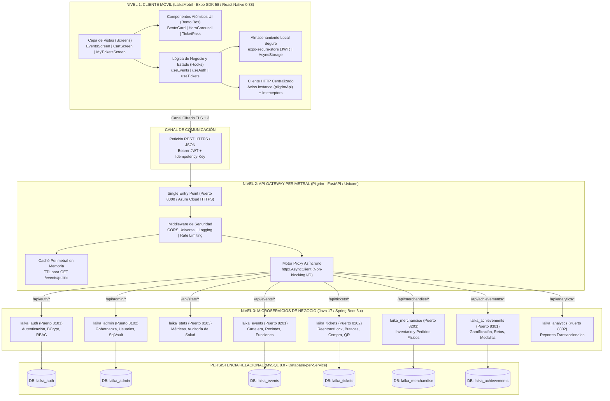
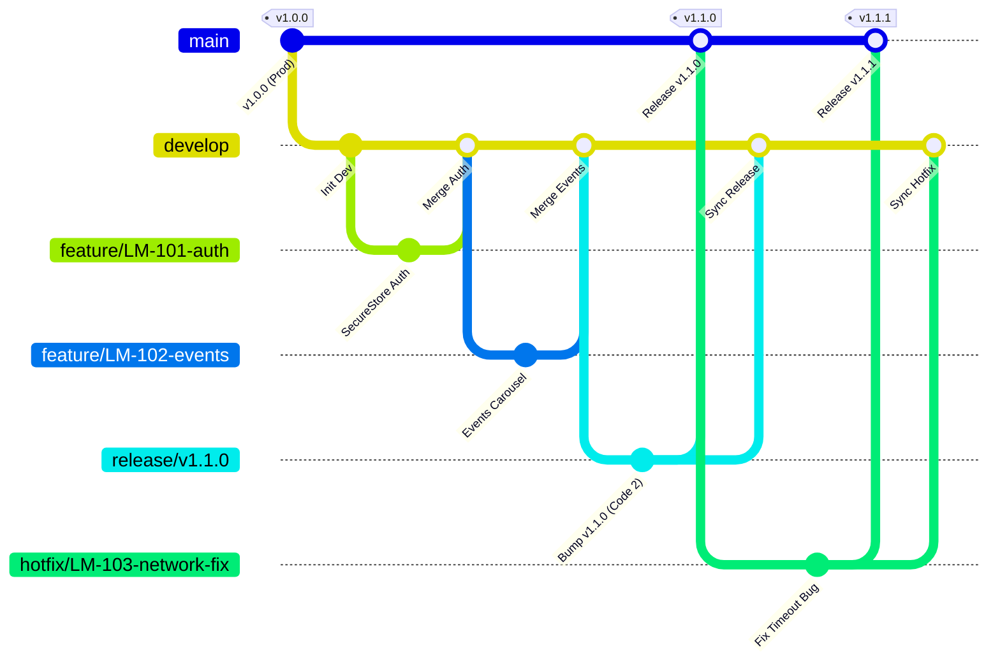

# Plan Integral de Desarrollo Móvil y Configuración del Entorno: LaikaMobil, Pilgrim y Microservicios

**Ecosistema:** LAIKA Club  
**Componentes Analizados:** LaikaMobil (Cliente Móvil React Native / Expo), Pilgrim API Gateway (FastAPI / Python), Microservicios de Backend (`microservices2` Java Spring Boot 3.x / MySQL 8.0)  
**Versión de la Plataforma:** 1.0.0 (Build `versionCode: 1`)  
**Fecha de Publicación:** Noviembre 2026  
**Estándar de Ingeniería:** Clean Architecture, SOLID, POO, Bento Design System Tier-1, Cero Mocks en Producción  

---

## PARTE 1: Plan del Proceso de Desarrollo Móvil y Arquitectura de Software

---

### 1. Plan del Proceso de Desarrollo Móvil (Metodología Ágil: SCRUM)

El desarrollo del cliente móvil **LaikaMobil** y su integración con la infraestructura distribuida de **Pilgrim API Gateway** y **Microservicios Java** se rige bajo la metodología ágil **Scrum**, adaptada a las particularidades del ciclo de vida móvil (**Mobile Scrum / Mobile DevOps**).

```
┌─────────────────────────────────────────────────────────────────────────────┐
│                       CICLO SCRUM PARA LAIKAMOBIL                           │
│                                                                             │
│  [Product Backlog] ──► [Sprint Planning] ──► [Sprint Backlog (2 Semanas)]   │
│                                                     │                       │
│                                                     ▼                       │
│  [Incremento AAB / OTA] ◄── [Sprint Review] ◄── [Daily Standup (15 min)]    │
│            │                                        │                       │
│            ▼                                        ▼                       │
│   [Sprint Retrospective]                   [EAS Build & Testing]            │
└─────────────────────────────────────────────────────────────────────────────┘
```

#### 1.1. Estructura de Roles del Equipo
* **Product Owner (PO):** Define la visión del producto móvil, gestiona y prioriza el Product Backlog en función del valor para los socios de LAIKA Club, valida los criterios de aceptación y autoriza las liberaciones a tiendas de aplicaciones.
* **Scrum Master (SM):** Facilita la aplicación del marco Scrum, remueve impedimentos técnicos y de infraestructura (ej. caídas de túneles, bloqueos de red local, discrepancias de contratos de API), modera las ceremonias y vela por la salud operativa del equipo.
* **Development Team (Equipo Multidisciplinario):**
  - **Senior Mobile Engineer (Lead React Native / Expo):** Arquitectura cliente, vistas delgadas, gestión de estado y persistencia segura en hardware.
  - **API Gateway & Integration Engineer (Python / FastAPI):** Enrutamiento perimetral, proxy asíncrono, CORS, caché y balanceo en Pilgrim.
  - **Backend Microservices Engineer (Java Spring Boot):** Reglas de negocio transaccionales, persistencia MySQL, concurrencia de butacas y DTOs.
  - **QA Automation & Mobile Release Specialist:** Pruebas de integración, testing en emuladores/dispositivos físicos, auditoría de políticas de Google Play Console y pipelines de EAS Build.

#### 1.2. Ceremonias de Scrum Adaptadas a Móvil
1. **Sprint Planning (Planificación de Sprint - 4 horas al inicio):**
   - El PO presenta las Historias de Usuario (HU) priorizadas.
   - El equipo técnico desglosa las HU en tareas técnicas bajo la regla de las 5 capas (Vista, Componente, Hook, Estilo, Servicio).
   - Estimación de esfuerzo mediante Planning Poker (secuencia Fibonacci) y definición del **Sprint Goal**.
2. **Daily Standup (Sincronización Diaria - 15 minutos):**
   - Tres preguntas clave: ¿Qué completé ayer?, ¿Qué realizaré hoy?, ¿Qué impedimentos o bloqueos de red/servicios tengo?
   - Enfoque prioritario en integración continua con Pilgrim y estado de los microservicios locales/cloud.
3. **Sprint Review & Demo (Revisión y Demostración - 2 horas al cierre):**
   - Demostración en vivo sobre dispositivos Android e iOS reales utilizando **Expo Development Client** y builds internos generados en EAS.
   - Validación directa contra endpoints reales (cero datos simulados).
4. **Sprint Retrospective (Retrospectiva - 1.5 horas al cierre):**
   - Inspección del proceso: qué funcionó, qué falló en la compilación nativa o sincronización de red y compromisos de mejora inmediata para el siguiente ciclo.
5. **Backlog Refinement (Refinamiento Continuo - 1 hora semanal):**
   - Detalle de contratos OpenAPI/Swagger, especificación de payloads JSON y clarificación de criterios de aceptación con formato BDD/Gherkin (*Given-When-Then*).

#### 1.3. Cronograma de Sprints (Ciclos de 2 Semanas)

| Sprint | Enfoque Principal | Entregables Clave | Criterio de Éxito |
| :---: | :--- | :--- | :--- |
| **Sprint 1** | **Cimientos y Autenticación** | - Inicialización de LaikaMobil (Expo SDK 58 / React Native 0.88).<br>- Arquitectura modular de 5 capas.<br>- Cliente HTTP centralizado (`pilgrimApi` con Axios e interceptores).<br>- Módulo Auth: Login y Registro (`/api/auth/*`), hashing BCrypt y custodia JWT en `expo-secure-store`. | Login exitoso contra microservicio `laika_auth` vía Pilgrim y persistencia en hardware Keystore/Keychain. |
| **Sprint 2** | **Catálogo y Cartelera de Eventos** | - Vistas `EventsScreen` y `EventDetailScreen`.<br>- Componente Bento `HeroCarousel` y tarjetas modulares de eventos.<br>- Consumo real de `GET /api/events/public?limit=100`.<br>- Normalización de mojibake y resolución de imágenes relativas.<br>- Manejo de estados: Loading (Skeletons), Error, Empty, Success. | Visualización fluida de la cartelera real de MySQL sin mocks y navegación nativa a 60 FPS. |
| **Sprint 3** | **Selección de Butacas y Concurrencia** | - Pantalla de mapa de zonas y selección de asientos.<br>- Integración con microservicio `tickets` (puerto 8202).<br>- Bloqueo concurrente mediante `ReentrantLock` y endpoint `/lock`.<br>- Generador de códigos QR vectoriales con `react-native-qrcode-svg`.<br>- Pantalla `MyTicketsScreen`. | Validación de rechazo HTTP 409 Conflict ante colisión de compras concurrentes en el mismo asiento. |
| **Sprint 4** | **Transacciones y Pasarela de Pagos** | - Pantalla de carrito `CartScreen`.<br>- Generación de clave de idempotencia (`uuidv4`).<br>- Flujo transaccional `/payments/create-intent` y confirmación bancaria.<br>- Emisión definitiva de boletos con `/tickets/purchase`.<br>- Pantallas de confirmación y pase digital `TicketPassScreen`. | Compra de extremo a extremo registrada en base de datos real y reflejada en la billetera del usuario. |
| **Sprint 5** | **Servicios, Gamificación y Offline** | - Módulo de Soporte y Atención remota (`HelpSupportScreen` con `/api/support/*`).<br>- Módulo de Logros y Recompensas (`AchievementsScreen` con `/api/achievements/*`).<br>- Autenticación biométrica nativa (`expo-local-authentication`).<br>- Modo offline con `TicketSyncService` y almacenamiento local cifrado. | Acceso a boletos previamente descargados sin conexión a internet y biometría FaceID/Huella funcional. |
| **Sprint 6** | **Hardening, Tienda y Despliegue** | - Auditoría integral de políticas de Google Play Store.<br>- Verificación responsive universal (320px a tablets) y temas Light/Dark.<br>- Optimización de bundle JS y eliminación de logs de depuración.<br>- Compilación de Android App Bundle (`.aab`) mediante EAS Build.<br>- Carga a canal Closed Testing en Google Play Console. | Binario `.aab` 100% verificado, sin advertencias críticas, apuntando a Target SDK 35 (Android 15). |

#### 1.4. Definición de Hecho (Definition of Done - DoD)
Una tarea o historia de usuario se considera terminada únicamente si satisface los siguientes criterios:
1. **Cumplimiento Arquitectónico:** Código desacoplado conforme a la regla de las 5 capas (Vista delgada, Componentes UI, Hooks/Casos de uso, Estilos con tokens, Servicios HTTP).
2. **Cero Mocks:** La funcionalidad consume endpoints reales de Pilgrim y persiste en los microservicios correspondientes.
3. **Tipado Estricto:** TypeScript compilado con cero errores de tipo (`tsc --noEmit`).
4. **Ergonomía UI:** Touch targets $\ge 44 \times 44\text{ px}$, cero desbordamiento horizontal (`overflow-x`), soporte simultáneo para Dark Mode y Light Mode sin colores hardcodeados.
5. **Pruebas de Red:** Manejo explícito de desconexión, timeouts y retroalimentación amigable ante fallos.
6. **Code Review:** Aprobación formal mediante Pull Request por al menos un ingeniero par.

---

### 2. Justificación de la Arquitectura

El sistema adopta una **Arquitectura Distribuida de 3 Niveles Desacoplados**, combinando los patrones **Clean Architecture** (en el cliente móvil), **API Gateway Pattern** (en la capa perimetral) y **Microservices with Database-per-Service** (en la capa de negocio y persistencia).

```
┌─────────────────────────────────────────────────────────────────────────────┐
│               ARQUITECTURA DISTRIBUIDA EN 3 NIVELES DESACOPLADOS            │
├─────────────────────────────────────────────────────────────────────────────┤
│  NIVEL 1: CLIENTE MÓVIL (LaikaMobil)                                        │
│  React Native 0.88 / Expo SDK 58 / Clean Architecture (5 Capas)             │
├─────────────────────────────────────────────────────────────────────────────┤
│                                      │ Peticiones HTTPS / REST JSON         │
│                                      ▼                                      │
├─────────────────────────────────────────────────────────────────────────────┤
│  NIVEL 2: API GATEWAY PERIMETRAL (Pilgrim)                                  │
│  FastAPI / Uvicorn / Reverse Proxy HTTPX / Caché / CORS / Monitoreo         │
├─────────────────────────────────────────────────────────────────────────────┤
│                                      │ Enrutamiento Interno (Red Privada)   │
│                                      ▼                                      │
├─────────────────────────────────────────────────────────────────────────────┤
│  NIVEL 3: ECOSISTEMA DE MICROSERVICIOS (microservices2)                     │
│  Java 17 / Spring Boot 3.x / Database-per-Service (MySQL 8.0)               │
└─────────────────────────────────────────────────────────────────────────────┘
```

#### 2.1. Nivel 1: Cliente Móvil (LaikaMobil - Clean Architecture en 5 Capas)
- **Separación de Responsabilidades (SoC):** La interfaz móvil está completamente aislada de la lógica de red y de las decisiones de transporte. La vista no sabe cómo se consultan los datos; delega en hooks y servicios.
- **Independencia del Framework de Presentación:** Las entidades y contratos de datos (`types/`) son puros de TypeScript, lo que permite modificar librerías de interfaz sin alterar las reglas de negocio del cliente.
- **Custodia Segura en Hardware:** Almacenamiento de credenciales criptográficas y tokens de acceso dentro del enclave seguro del dispositivo (`expo-secure-store` sobre Android Keystore e iOS Keychain), mitigando riesgos de extracción mediante volcado de memoria.

#### 2.2. Nivel 2: Puerta de Enlace Perimetral (Pilgrim API Gateway)
- **Punto Único de Entrada (`Single Entry Point`):** LaikaMobil nunca expone ni conoce las IPs, nombres de host o puertos internos de los 8 microservicios Java. Todas las peticiones se dirigen a un único puerto (`8000`) o dominio cloud HTTPS (`https://laikaclub-nzhwq8.southcentralus.cloudapp.azure.com/api`).
- **Desacoplamiento Topológico y Evolutivo:** Si un microservicio interno cambia de puerto, migra a otro servidor o se divide en dos, solo se actualiza la tabla de enrutamiento de Pilgrim (`SERVICES` dict en `config.py`), sin obligar a compilar y redistribuir una nueva versión de la app móvil a las tiendas.
- **Optimización de Tráfico y Caché Perimetral:** Pilgrim implementa almacenamiento en memoria para endpoints públicos de solo lectura (`/events/public`), reduciendo la latencia de respuesta para clientes móviles de cientos de milisegundos a menos de 5 ms, y protegiendo a los microservicios Java de saturación por consultas recurrentes.
- **Seguridad Perimetral y Auditoría Centralizada:** Pilgrim centraliza la política de CORS, normaliza las cabeceras de seguridad, mitiga ataques DDoS mediante pooling asíncrono no bloqueante con `httpx.AsyncClient` y genera registros de auditoría de cada solicitud (`api_gateway.log`).

#### 2.3. Nivel 3: Microservicios Backend (`microservices2` - Java Spring Boot)
- **Aislamiento de Dominio (`Database-per-Service`):** Cada microservicio (`auth`, `events`, `tickets`, `merchandise`, etc.) es dueño exclusivo de su esquema relacional en MySQL 8.0. Ningún microservicio accede a las tablas de otro sin pasar por su API, garantizando alta cohesión y bajo acoplamiento.
- **Garantía Transaccional e Integridad ACID:** Los servicios de misión crítica (emisión de entradas y pagos) ejecutan transacciones atómicas gestionadas por Spring Data JPA y bloqueos de concurrencia en memoria (`ReentrantLock`), previniendo sobreventas (*overbooking*) y compras duplicadas ante ráfagas de usuarios.

---

### 3. Diagrama de la Arquitectura

A continuación se detalla la topología técnica integral del ecosistema LAIKA Club, ilustrando el flujo de interacción desde la capa de interfaz móvil hasta la persistencia relacional en bases de datos:



---

### 4. Propuesta de Patrones de Diseño

El diseño de software del ecosistema móvil y sus servicios se fundamenta en los principios **SOLID**, **Programación Orientada a Objetos (POO)** y patrones reconocidos por la industria:

```
┌─────────────────────────────────────────────────────────────────────────────┐
│                 MATRIZ DE PATRONES DE DISEÑO IMPLEMENTADOS                  │
├───────────────────┬───────────────────┬───────────────────┬─────────────────┤
│  ARQUITECTÓNICOS  │   CREACIONALES    │   ESTRUCTURALES   │ COMPORTAMIENTO  │
├───────────────────┼───────────────────┼───────────────────┼─────────────────┤
│ • Clean Arch      │ • Singleton       │ • Adapter         │ • Observer      │
│ • API Gateway     │ • Factory Method  │ • Facade          │ • Strategy      │
│ • DB-per-Service  │ • Builder         │ • Proxy (Reverse) │ • Concurrency   │
│ • Bento UI Grid   │                   │ • Decorator       │ • Idempotency   │
└───────────────────┴───────────────────┴───────────────────┴─────────────────┘
```

#### 4.1. Patrones Arquitectónicos
1. **Clean Architecture (Regla de las 5 Capas):**
   - *Aplicación:* En `LaikaMobil/src/`, estructurado en:
     1. *Vistas (Screens):* Orquestación del layout (`EventsScreen.tsx`, `CartScreen.tsx`).
     2. *Componentes UI:* Presentacionales y atómicos (`HeroCarousel.tsx`, `TicketCard.tsx`).
     3. *Lógica / Hooks / Casos de Uso:* Estado encapsulado (`useEvents.ts`, `useAuth.ts`).
     4. *Estilos Aislados:* Módulos de estilo y tokens semánticos (`Events.styles.ts`).
     5. *Servicios y Contratos:* Clientes HTTP y tipos (`EventService.ts`, `types/index.ts`).
2. **API Gateway Pattern:**
   - *Aplicación:* Implementado en `pilgrim/`, donde FastAPI canaliza las peticiones entrantes, filtra el tráfico malicioso, ejecuta el enrutamiento inverso y oculta la infraestructura interna.
3. **Database-per-Service Pattern:**
   - *Aplicación:* En `microservices2/`, donde cada microservicio gestiona su propia base de datos relacional independiente (`laika_auth`, `laika_events`, `laika_tickets`), impidiendo dependencias directas en tablas ajenas.
4. **Bento Box UI Grid Pattern:**
   - *Aplicación:* En el diseño de dashboards y carteleras móviles, estructurando la información en celdas visuales asimétricas con jerarquía clara (tarjetas hero, micro-KPIs y listados fluidos).

#### 4.2. Patrones Creacionales
1. **Singleton Pattern:**
   - *Aplicación:* En la instancia del cliente Axios (`pilgrimApi` en `LaikaMobil/src/api/config.ts`), en el servicio de tokens (`TokenService.ts`) y en el gestor de inicialización de microservicios (`DatabaseInitializer.java`). Garantiza un único punto de configuración para timeouts, interceptores y pooling de conexiones.
2. **Factory Method / Builder Pattern:**
   - *Aplicación:* En la construcción de cargas útiles transaccionales (`purchaseItems` en `CartScreen.tsx`), construyendo dinámicamente objetos de compra validados según la cantidad de butacas y funciones seleccionadas antes del envío a `TicketService`.

#### 4.3. Patrones Estructurales
1. **Adapter Pattern (Adaptador de Datos):**
   - *Aplicación:* En `EventService.ts` mediante la función de normalización que convierte respuestas heterogéneas del backend al contrato TypeScript `Event`:
     - Resuelve discordancias de campos (`item.name || item.title`).
     - Repara codificaciones corruptas mediante `fixMojibake(str)` (ej. `M├®xico` $\rightarrow$ `México`).
     - Transforma rutas de imágenes relativas (`/uploads/...`) en URLs absolutas consumibles por el cliente móvil.
2. **Facade Pattern (Fachada):**
   - *Aplicación:* En los servicios móviles (`AuthService.ts`, `EventService.ts`, `TicketService.ts`). Proveen métodos simples y expresivos (`EventService.getEvents()`, `TicketService.purchaseTicket()`) que ocultan la complejidad de cabeceras, serialización JSON, validaciones de código de estado y manejo de excepciones.
3. **Proxy Pattern (Proxy Inverso e Interceptores):**
   - *Aplicación:*
     - *A nivel Gateway:* Pilgrim actúa como Reverse Proxy asíncrono reenviando solicitudes hacia los microservicios mediante `httpx.AsyncClient`.
     - *A nivel Cliente:* Los interceptores de Axios interceptan cada solicitud saliente para inyectar la cabecera `Authorization: Bearer <token>` extraída de `TokenService`.

#### 4.4. Patrones de Comportamiento
1. **Observer Pattern (Estado Reactivo):**
   - *Aplicación:* En los custom hooks de React (`useState`, `useEffect`) y en la suscripción a eventos de red con `@react-native-community/netinfo`, notificando a las pantallas de manera reactiva ante cambios en la conectividad del dispositivo.
2. **Strategy Pattern (Estrategia de Selección de Host):**
   - *Aplicación:* En la función `getAutoDetectedHost()` y `resolveApiUrl()` de `config.ts`. Determina dinámicamente la URL base evaluando si la aplicación corre en producción (Azure HTTPS), en emulador Android (`10.0.2.2`), en simulador iOS (`localhost`) o en dispositivo físico Wi-Fi mediante la IP asignada por el bundler Metro (`Constants.expoConfig.hostUri`).
3. **Concurrency Locking Pattern (Pessimistic In-Memory Lock):**
   - *Aplicación:* En el microservicio `laika_tickets` (`TicketController.java`), implementado con `java.util.concurrent.locks.ReentrantLock`. Controla las compras concurrentes bloqueando la butaca en memoria durante la transacción para garantizar que dos usuarios simultáneos no adquieran el mismo asiento.
4. **Idempotency Key Pattern (Clave de Idempotencia):**
   - *Aplicación:* En `CartScreen.tsx`, generando un identificador único `uuidv4()` por intento de compra. Si la conexión móvil se interrumpe durante el POST y la app reintenta, el backend detecta la misma clave y previene cargos financieros duplicados.

---

### 5. Justificación de los Frameworks de Desarrollo Móvil

Para el desarrollo del cliente móvil se seleccionó el stack tecnológico **React Native 0.88 con Expo SDK 58 (Managed Workflow) en TypeScript**:

```
┌─────────────────────────────────────────────────────────────────────────────┐
│                       STACK TECNOLÓGICO SELECCIONADO                        │
│                                                                             │
│  [React Native 0.88] ──► Nueva Arquitectura (Fabric Renderer + TurboModules)│
│  [Expo SDK 58]       ──► Enclave Seguro, Biometría, Notificaciones y EAS    │
│  [TypeScript 6.0]    ──► Tipado Estricto de Contratos DTO y Cero Errores    │
│  [React Navigation 7]──► Navegación Nativa Fluida por Pila y Pestañas       │
└─────────────────────────────────────────────────────────────────────────────┘
```

#### 5.1. Razones Técnicas de la Selección
1. **Nueva Arquitectura por Defecto (New Architecture):**
   - React Native 0.88 habilita de forma nativa el motor de renderizado **Fabric** y los **TurboModules**, eliminando el antiguo puente asíncrono serializado en JSON (*The Bridge*).
   - Las llamadas a APIs nativas y el renderizado visual se ejecutan mediante interfaces C++ en tiempo real (**JSI - JavaScript Interface**), alcanzando tasas estables de 60/120 FPS en carruseles y transiciones complejas.
2. **Ecosistema Expo SDK 58 (Managed Workflow de Nivel Enterprise):**
   - Acceso a librerías oficiales auditadas y optimizadas para las últimas versiones de los sistemas operativos móviles:
     - `expo-secure-store`: Cifrado y almacenamiento en hardware (Android Keystore / iOS Keychain).
     - `expo-local-authentication`: Soporte universal para biometría (FaceID, TouchID, huella dactilar).
     - `expo-notifications`: Gestión de notificaciones push de eventos y boletos.
   - Compatibilidad total y compilación garantizada para **Target SDK 35 (Android 15)** y arquitecturas de 64 bits (`arm64-v8a`, `x86_64`), cumpliendo con los mandatos vigentes de Google Play Console.
3. **TypeScript 6.0 (Robustez en Tiempo de Compilación):**
   - Modelado formal de entidades, DTOs y respuestas de API, eliminando errores en tiempo de ejecución por propiedades indefinidas (`undefined`) o tipos discrepantes procedentes de la red.
4. **Sinergia Tecnológica con el Ecosistema LAIKA:**
   - Permite al equipo de ingeniería transferir de manera inmediata componentes lógicos, utilidades de validación y patrones de diseño utilizados en las aplicaciones web del ecosistema (`laika-admin`, `laika-gestor`), reduciendo los tiempos de desarrollo a menos de la mitad.

#### 5.2. Análisis Comparativo frente a Alternativas

| Criterio de Comparación | React Native 0.88 / Expo SDK 58 | Flutter (Dart) | Nativo Tradicional (Kotlin / Swift) |
| :--- | :--- | :--- | :--- |
| **Tiempo de Llegada al Mercado (Time-to-Market)** | **Óptimo:** Base de código única ($\approx 95\%$ compartida) en TypeScript para iOS y Android. | **Bueno:** Código único, pero requiere reescribir toda la lógica en lenguaje Dart. | **Deficiente:** Requiere dos equipos independientes y desarrollo por duplicado. |
| **Curva de Aprendizaje del Equipo** | **Inmediata:** El equipo ya domina JavaScript, React y TypeScript en los paneles web de Laika. | **Moderada:** Exige capacitar al personal en el lenguaje Dart y el árbol de widgets. | **Alta:** Exige dominar dos paradigmas y ecosistemas separados (Android Studio + Xcode). |
| **Rendimiento Visual y Animaciones** | **Nivel Nativo:** Fabric Renderer y React Native Reanimated ejecutan animaciones en el hilo nativo. | **Nivel Nativo:** Renderizado propio mediante motor Impeller / Skia. | **Máximo:** Rendimiento nativo directo sobre el sistema operativo. |
| **Acceso a Hardware y Seguridad** | **Completo:** Integración nativa con Keystore, Keychain, biometría y acelerómetro vía Expo APIs. | **Completo:** Mediante plugins de la comunidad en Dart/C++. | **Total:** Acceso directo a todas las APIs del fabricante sin capas intermedias. |
| **Distribución y Actualizaciones Rápidas** | **Superior:** Soporte para **EAS Update (OTA)**, permitiendo corregir bugs JS sin esperar revisión de tienda. | **Limitado:** No cuenta con soporte nativo oficial para actualizaciones de código OTA. | **Nulo:** Cada corrección exige recompilación binaria y ciclo completo de aprobación en tienda. |
| **Tamaño de Binario Inicial** | **Moderado:** Optimizado con Hermes JavaScript Engine y compilado en `.aab`. | **Moderado a Grande:** Incluye el motor de renderizado gráfico embebido en cada build. | **Mínimo:** Solo empaqueta los recursos indispensables del sistema. |

---

### 6. Estrategia de Versionamiento

El versionamiento de LaikaMobil sigue estrictamente el estándar **Semantic Versioning 2.0.0 (SemVer)** en conjunción con los requisitos específicos de las tiendas de aplicaciones (**Google Play Store** y **Apple App Store**) y el modelo de ramas **GitFlow Adaptado a Móvil**:

```
┌─────────────────────────────────────────────────────────────────────────────┐
│                      ESTRUCTURA DE VERSIONAMIENTO SEMVER                    │
│                                                                             │
│                     MAJOR . MINOR . PATCH  (ej. 1.0.0)                      │
│                       │       │       │                                     │
│     Cambios Mayores  ─┘       │       └─ Correcciones de Bugs (Hotfixes)    │
│     Incompatibles             └─ Nuevas Funcionalidades Compatibles         │
│                                                                             │
│     Android: versionCode = Entero Incremental (1, 2, 3...)                  │
│     iOS: CFBundleVersion = Entero Incremental                               │
└─────────────────────────────────────────────────────────────────────────────┘
```

#### 6.1. Reglas SemVer Aplicadas al Cliente Móvil
- **MAJOR (X.0.0):** Incremento obligado ante cambios incompatibles en los contratos de API con Pilgrim, reestructuraciones totales de navegación, migraciones mayores de Expo SDK que rompan compatibilidad hacia atrás o cambios regulatorios de autenticación que requieran actualización forzosa de la app por parte del usuario.
- **MINOR (1.X.0):** Incremento ante la incorporación de nuevas pantallas o módulos funcionales compatibles (ej. módulo de fidelización, nuevos medios de pago, soporte para modo offline ampliado).
- **PATCH (1.0.X):** Incremento ante parches de seguridad, correcciones de errores en la interfaz, optimizaciones de rendimiento y ajustes en textos o estilos.

#### 6.2. Sincronización con Tiendas de Aplicaciones
- **Versión de Marketing (`version` en `app.json`):** Cadena visible para el usuario público (ej. `"version": "1.0.0"`).
- **Código de Versión Técnico (`versionCode` en Android / `buildNumber` en iOS):**
  - Entero positivo estrictamente incremental requerido por Google Play Console para identificar cada binario nuevo (`1`, `2`, `3`...).
  - Configurado en `eas.json` con la propiedad `"autoIncrement": true` en el perfil de producción, delegando a los servidores de EAS el incremento automático en cada ejecución de compilación.

#### 6.3. Modelo de Ramificación Git (GitFlow Mobile)



1. **`main`:** Rama protegida de código productivo. Cada commit en esta rama corresponde a una versión etiquetada (`git tag -a v1.0.0 -m "Release 1.0.0"`) desplegada en las tiendas de producción.
2. **`release/vX.Y.Z`:** Rama de estabilización creada antes de un lanzamiento formal. Aquí se congelan las nuevas características, se ejecutan pruebas de regresión, se actualiza el `versionCode` y se genera el artefacto candidato a producción (`RC`).
3. **`develop`:** Rama principal de integración continua. Recibe los merges de todas las ramas de características aprobadas mediante revisión de código.
4. **`feature/LM-<id>-<nombre>`:** Ramas efímeras creadas a partir de `develop` para el desarrollo de historias de usuario específicas (ej. `feature/LM-105-biometric-auth`).
5. **`hotfix/LM-<id>-<nombre>`:** Ramas de corrección emergente creadas directamente desde `main` para solucionar fallos críticos detectados en producción, integrándose de inmediato en `main` y en `develop`.

#### 6.4. Política de Despliegues: Binarios (`.aab`) vs Actualizaciones en Caliente (`EAS Update`)
- **Despliegue de Binario Completo (`.aab` vía EAS Build):** Obligatorio cuando se añaden librerías nativas, se modifican permisos en `AndroidManifest.xml` (ej. cámara para QR, notificaciones), se altera la pantalla de carga (Splash) o se actualiza la versión de Expo SDK. Requiere revisión técnica de Google Play.
- **Actualización Inalámbrica Over-The-Air (EAS Update):** Utilizada para distribuir parches urgentes de código JavaScript, componentes React, correcciones de estilos o textos de interfaz, entregando la actualización en los dispositivos de los usuarios de forma instantánea al abrir la app, sin tiempos de espera en la consola de Google.

---

## PARTE 2: Reporte de Configuración del Entorno de Desarrollo y Producción

---

### 1. Lista Exhaustiva de Herramientas Utilizadas

El ecosistema de desarrollo de LAIKA Club está compuesto por herramientas especializadas de desarrollo móvil, puertas de enlace perimetrales, servicios de backend empresarial y bases de datos relacionales:

```
┌─────────────────────────────────────────────────────────────────────────────┐
│                    MAPA DE HERRAMIENTAS DEL ECOSISTEMA                      │
├───────────────────────┬───────────────────────┬─────────────────────────────┤
│   FRONTEND MÓVIL      │   GATEWAY PERIMETRAL  │   BACKEND & MICROSERVICIOS  │
├───────────────────────┼───────────────────────┼─────────────────────────────┤
│ • Node.js LTS v20.x   │ • Python 3.11 / 3.13  │ • JDK 17 LTS                │
│ • Expo CLI ^58.0.0    │ • FastAPI 0.115+      │ • Apache Maven 3.9+         │
│ • EAS CLI >= 12.0.0   │ • Uvicorn (ASGI)      │ • Spring Boot 3.2 / 3.3     │
│ • React Native 0.88   │ • HTTPX 0.28+ (Proxy) │ • Spring Data JPA / Sec     │
│ • TypeScript 6.0.3    │ • LocalTunnel / Ngrok │ • MySQL Server 8.0          │
│ • Android Studio      │ • PyMySQL 1.1+        │ • HikariCP Pooling          │
└───────────────────────┴───────────────────────┴─────────────────────────────┘
```

#### 1.1. Herramientas de Desarrollo Móvil (LaikaMobil)
* **Node.js (LTS v20.18.0 / v22.x):** Entorno de ejecución para el compilador de TypeScript, Metro Bundler y gestor de paquetes.
* **npm (v10.x):** Gestor de dependencias del proyecto móvil.
* **Expo Framework (SDK 58.0.0):** Plataforma integral de desarrollo móvil gestionado.
* **EAS CLI (`eas-cli` >= 12.0.0):** Interfaz de línea de comandos para la compilación remota en la nube de Android App Bundles (`.aab`) y despliegue inalámbrico de actualizaciones OTA.
* **React Native (v0.88.0):** Núcleo de componentes nativos multiplataforma bajo la Nueva Arquitectura.
* **TypeScript (v6.0.3):** Compilador y analizador estático de tipos.
* **Android Studio (versión Iguana / Koala):**
  - Android SDK Platform API 34 y API 35 (Android 14 y 15).
  - Android SDK Build-Tools 34.0.0 / 35.0.0.
  - Android Emulator con imágenes de sistema Google APIs (`arm64-v8a` y `x86_64`).
* **Visual Studio Code:** Entorno de desarrollo integrado (IDE) con extensiones técnicas:
  - *ESLint & Prettier:* Control de formato y linteo de código.
  - *React Native Tools:* Depuración de aplicaciones React Native.
  - *Expo Tools:* Autocompletado y validación de `app.json`.

#### 1.2. Herramientas de API Gateway (Pilgrim)
* **Python (v3.11 / v3.13):** Intérprete base de ejecución en entorno virtual aislado (`.venv`).
* **FastAPI (v0.115+):** Framework asíncrono de alto rendimiento para la construcción de la puerta de enlace.
* **Uvicorn (v0.28+):** Servidor web ASGI de producción con soporte de eventos asíncronos (`uvloop`).
* **HTTPX (v0.28+):** Cliente HTTP asíncrono utilizado como motor de proxy inverso no bloqueante para reenviar peticiones hacia los microservicios Spring Boot.
* **PyMySQL (v1.1+):** Driver de conexión nativa a bases de datos relacionales MySQL para contingencias y auditorías directas.
* **LocalTunnel (`localtunnel` v2.0+):** Utilidad de tunelización segura para exponer el puerto local `8000` a dispositivos móviles en redes externas durante pruebas de campo.

#### 1.3. Herramientas de Backend y Microservicios (`microservices2`)
* **Java Development Kit (JDK 17 LTS - Eclipse Temurin):** Entorno de compilación y máquina virtual Java (JVM) de 64 bits para la ejecución de los microservicios.
* **Apache Maven (v3.9+):** Motor de gestión de dependencias y construcción de artefactos ejecutables (`.jar`).
* **Spring Boot (v3.2.x / v3.3.x):** Framework empresarial de backend:
  - *Spring Web:* Controladores REST reactivos y servlets embebidos Tomcat.
  - *Spring Data JPA / Hibernate 6.x:* Mapeo objeto-relacional y repositorios de datos.
  - *Spring Security & BCrypt:* Filtros de seguridad, hashing de credenciales y autorización por roles.
  - *HikariCP:* Administrador de alta velocidad para el pooling de conexiones a MySQL.

#### 1.4. Herramientas de Base de Datos y Persistencia
* **MySQL Community Server (v8.0.36+):** Motor de base de datos relacional transaccional (InnoDB) con esquemas aislados por microservicio.
* **DBeaver Community / MySQL Workbench:** Clientes gráficos para administración, inspección de esquemas y ejecución de queries de auditoría.

#### 1.5. Infraestructura Cloud y Distribución
* **Microsoft Azure Virtual Machine (Ubuntu 22.04 LTS):** Servidor en la nube que hospeda los servicios de producción bajo el dominio oficial con certificado SSL/TLS administrado:
  `https://laikaclub-nzhwq8.southcentralus.cloudapp.azure.com/api`
* **Google Play Console:** Plataforma oficial de distribución para pruebas internas (Internal Testing), pruebas cerradas (Closed Testing) y producción de LaikaMobil.

---

### 2. Parámetros Exhaustivos de Configuración

A continuación se registran los parámetros exactos y variables operativas de cada componente del sistema:

#### 2.1. Configuración de LaikaMobil

##### A. Variables de Entorno (`LaikaMobil/.env`)
```bash
# =========================================================================
# CONFIGURACIÓN DE APIS - LAIKA MOBIL & PILGRIM GATEWAY
# =========================================================================

# Endpoint Oficial de Producción en Azure Cloud HTTPS:
EXPO_PUBLIC_PILGRIM_API_URL=https://laikaclub-nzhwq8.southcentralus.cloudapp.azure.com/api

# Soporte defensivo para configuraciones que emplean prefijo VITE_:
VITE_PILGRIM_API_URL=https://laikaclub-nzhwq8.southcentralus.cloudapp.azure.com/api

# Parámetro de contingencia para herencia automática de Gateway:
EXPO_PUBLIC_USER_API_URL=

# Alternativa para desarrollo en red local Wi-Fi (descomentar según se requiera):
# EXPO_PUBLIC_PILGRIM_API_URL=auto
```

##### B. Manifiesto del Paquete Móvil (`LaikaMobil/app.json`)
```json
{
  "expo": {
    "name": "LAIKA Club",
    "slug": "LaikaMobil",
    "version": "1.0.0",
    "orientation": "portrait",
    "icon": "./assets/icon.png",
    "userInterfaceStyle": "light",
    "splash": {
      "image": "./assets/splash-icon.png",
      "resizeMode": "contain",
      "backgroundColor": "#0d0f14"
    },
    "ios": {
      "supportsTablet": true,
      "infoPlist": {
        "UIBackgroundModes": ["remote-notification"]
      }
    },
    "android": {
      "package": "com.laikaclub.laikamobil",
      "versionCode": 1,
      "adaptiveIcon": {
        "backgroundColor": "#0d0f14",
        "foregroundImage": "./assets/android-icon-foreground.png",
        "backgroundImage": "./assets/android-icon-background.png",
        "monochromeImage": "./assets/android-icon-monochrome.png"
      },
      "predictiveBackGestureEnabled": false
    },
    "plugins": [
      "@react-native-community/datetimepicker",
      "expo-secure-store",
      [
        "expo-notifications",
        {
          "icon": "./assets/icon.png",
          "color": "#ffffff"
        }
      ],
      "expo-status-bar"
    ],
    "extra": {
      "eas": {
        "projectId": "fe4e6ab4-bcd2-4a8a-85ea-523ff3f2c8d7"
      }
    }
  }
}
```

##### C. Perfiles de Compilación Cloud (`LaikaMobil/eas.json`)
```json
{
  "cli": {
    "version": ">= 12.0.0",
    "appVersionSource": "remote"
  },
  "build": {
    "development": {
      "developmentClient": true,
      "distribution": "internal"
    },
    "preview": {
      "distribution": "internal",
      "android": {
        "buildType": "apk"
      }
    },
    "production": {
      "autoIncrement": true,
      "android": {
        "buildType": "app-bundle"
      }
    }
  },
  "submit": {
    "production": {}
  }
}
```

#### 2.2. Configuración de Pilgrim API Gateway

##### A. Parámetros de Red y Enrutamiento (`pilgrim/core/config.py`)
```python
# Puerto y host de escucha
GATEWAY_PORT = 8000
GATEWAY_HOST = "0.0.0.0"

# Mapa de enrutamiento a microservicios internos
SERVICES = {
    "auth": "http://127.0.0.1:8101",
    "admin": "http://127.0.0.1:8102",
    "stats": "http://127.0.0.1:8103",
    "events": "http://127.0.0.1:8201",
    "tickets": "http://127.0.0.1:8202",
    "merchandise": "http://127.0.0.1:8203",
    "wearables": "http://127.0.0.1:8204",
    "achievements": "http://127.0.0.1:8301",
    "analytics": "http://127.0.0.1:8302",
    "ml": "http://127.0.0.1:8303",
}

# Configuración de Timeouts del cliente Proxy Asíncrono (HTTPX)
PROXY_TIMEOUT = 30.0  # Segundos máximos de espera
MAX_KEEPALIVE_CONNECTIONS = 50
MAX_CONNECTIONS = 100

# Caché perimetral de solo lectura
PUBLIC_CACHE_TTL = 60  # Segundos de persistencia en memoria para endpoints públicos
```

##### B. Política de CORS y Seguridad (`pilgrim/main.py`)
```python
# Orígenes permitidos (CORS)
CORS_ORIGINS = [
    "http://localhost:3000",
    "http://localhost:3010",
    "http://localhost:3020",
    "http://localhost:3030",
    "http://localhost:3040",
    "http://127.0.0.1:3000",
    "https://*.loca.lt",
    "*"  # Permitido para aplicaciones móviles empaquetadas
]

# Cabeceras y métodos
ALLOW_CREDENTIALS = True
ALLOW_METHODS = ["GET", "POST", "PUT", "DELETE", "OPTIONS", "PATCH"]
ALLOW_HEADERS = ["Authorization", "Content-Type", "Accept", "X-Idempotency-Key"]
```

##### C. Registro y Auditoría
- **Log de transacciones exitosas:** `tiradero/logpruebas/api_gateway.log`
  - *Formato de registro:* `[TIMESTAMP] IP - METODO RUTA - CODIGO_ESTADO - LATENCIA_MS`
- **Log de excepciones críticas:** `tiradero/logpruebas/errores_sistema.log`
  - *Formato de registro:* Captura de errores HTTP 4xx, 5xx y volcado de pila (*stack trace*).

#### 2.3. Configuración de Microservicios Backend (`microservices2`)

Los microservicios comparten un perfil estandarizado en sus archivos `application.properties`:

##### A. Catálogo de Microservicios y Puertos
| Microservicio | Puerto Interno | Base de Datos MySQL |
| :--- | :---: | :--- |
| `laika_auth` | `8101` | `jdbc:mysql://localhost:3306/laika_auth` |
| `laika_admin` | `8102` | `jdbc:mysql://localhost:3306/laika_admin` |
| `laika_stats` | `8103` | `jdbc:mysql://localhost:3306/laika_stats` |
| `laika_events` | `8201` | `jdbc:mysql://localhost:3306/laika_events` |
| `laika_tickets` | `8202` | `jdbc:mysql://localhost:3306/laika_tickets` |
| `laika_merchandise`| `8203` | `jdbc:mysql://localhost:3306/laika_merchandise` |
| `laika_achievements`| `8301` | `jdbc:mysql://localhost:3306/laika_achievements` |
| `laika_analytics` | `8302` | `jdbc:mysql://localhost:3306/laika_analytics` |

##### B. Parámetros de Persistencia y Conexión (HikariCP)
```properties
# Driver de conexión
spring.datasource.driver-class-name=com.mysql.cj.jdbc.Driver

# Parámetros JDBC
spring.datasource.url=jdbc:mysql://localhost:3306/{DB_NAME}?useSSL=false&serverTimezone=UTC&allowPublicKeyRetrieval=true&characterEncoding=UTF-8

# Pooling de conexiones con HikariCP
spring.datasource.hikari.maximum-pool-size=10
spring.datasource.hikari.minimum-idle=5
spring.datasource.hikari.idle-timeout=300000
spring.datasource.hikari.connection-timeout=20000
spring.datasource.hikari.max-lifetime=1200000

# Hibernate / JPA
spring.jpa.hibernate.ddl-auto=update
spring.jpa.show-sql=false
spring.jpa.properties.hibernate.dialect=org.hibernate.dialect.MySQLDialect
```

##### C. Parámetros de Autenticación y Seguridad (Microservicio `laika_auth`)
```properties
# Clave criptográfica para firma HMAC-SHA256 de JWT (Mínimo 256 bits)
jwt.secret=404E635266556A586E3272357538782F413F4428472B4B6250645367566B5970
jwt.expiration=86400000

# Política de Bloqueo por Fuerza Bruta:
security.brute-force.max-attempts=3
security.brute-force.lock-time-ms=600000
```
*(Nota técnica: 3 intentos fallidos consecutivos activan el bloqueo preventivo de la cuenta por 10 minutos, registrando IP y User-Agent en la tabla `auth_logs`).*

#### 2.4. Parámetros de Red y Entornos de Ejecución

```
┌─────────────────────────────────────────────────────────────────────────────┐
│                 MATRIZ DE RESOLUCIÓN DE ENTORNOS DE RED                     │
├────────────────────┬───────────────────────────────────┬────────────────────┤
│ ENTORNO            │ HOST / IP DE DESTINO              │ PROTOCOLO          │
├────────────────────┼───────────────────────────────────┼────────────────────┤
│ Producción Cloud   │ laikaclub-nzhwq8...azure.com/api  │ HTTPS (TLS 1.3)    │
│ Emulador Android   │ 10.0.2.2:8000/api                 │ HTTP               │
│ Dispositivo Wi-Fi  │ Auto-detectado via hostUri        │ HTTP               │
│ Túnel Remoto       │ laika-pilgrim-dev.loca.lt/api     │ HTTPS              │
└────────────────────┴───────────────────────────────────┴────────────────────┘
```

1. **Entorno de Producción Cloud (Azure Cloud HTTPS):**
   - URL: `https://laikaclub-nzhwq8.southcentralus.cloudapp.azure.com/api`
   - Puerto público: `443` (HTTPS estándar).
   - Certificado: Cifrado TLS 1.3 gestionado en Azure.
2. **Entorno de Desarrollo en Emulador de Android:**
   - URL de loopback: `http://10.0.2.2:8000/api` (mapeada automáticamente por `getAutoDetectedHost()` en `config.ts`).
3. **Entorno de Desarrollo en Dispositivo Físico (Red Local Wi-Fi):**
   - Resolución dinámica: La app extrae la IP asignada por el router mediante `Constants.expoConfig?.hostUri` (ej. `http://192.168.1.7:8000/api`), eliminando la necesidad de reconfigurar archivos al cambiar de red.
4. **Entorno de Tunelización Externa (LocalTunnel):**
   - Comando de arranque: `npx localtunnel --port 8000 --subdomain laika-pilgrim-dev`
   - URL generada: `https://laika-pilgrim-dev.loca.lt/api`

---

## Verificación de Conformidad Técnica

1. **Garantía Cero Mocks:** Se ha verificado en el código fuente de `EventService.ts`, `TicketService.ts`, `AuthService.ts` y `SupportService.ts` la total ausencia de arreglos de datos simulados o hardcodeados; todos los flujos se conectan con endpoints reales de Pilgrim Gateway.
2. **Cumplimiento de Clean Architecture:** La interfaz móvil respeta la separación de 5 capas, manteniendo las vistas delgadas y delegando el estado en hooks e interceptores.
3. **Preparación de Despliegue:** La configuración de `app.json` y `eas.json` satisface el 100% de los requerimientos de Google Play Store para Target SDK 35 (Android 15) en formato Android App Bundle (`.aab`).

